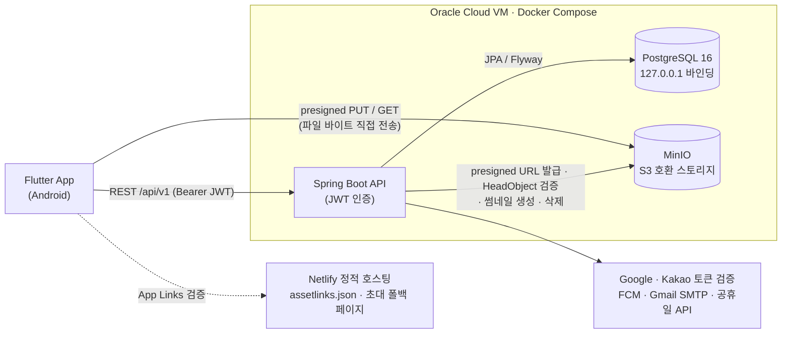
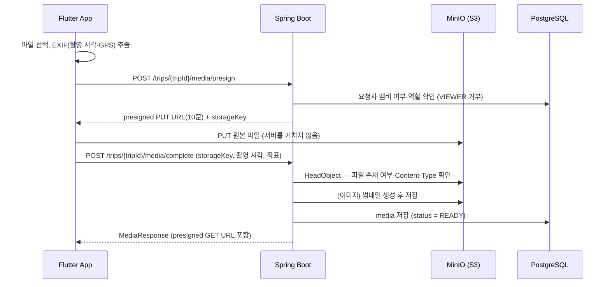

# TripMapTrace

> 여행 중 찍은 사진·영상을 **촬영 시각과 GPS 위치를 기준으로 타임라인과 지도 경로**에 함께 보여 주는 여행 기록 공유 앱 (Flutter + Spring Boot)

여러 명이 함께 다닌 여행이라도 사진은 각자의 휴대폰에 흩어져 있고, 갤러리 앱은 "언제 어디를 거쳐 갔는지"를 보여 주지 못합니다.
TripMapTrace는 여행(Trip) 단위로 멤버를 초대해 사진·영상을 한곳에 모으고, EXIF의 촬영 시각과 GPS 좌표로 **시간순 타임라인**과 **이동 경로 지도**를 자동으로 만들어 줍니다.

- 개인 프로젝트 (기획·백엔드·앱·배포 전부 1인 개발)
- 실제 클라우드 VM에 배포해 Android 실기기로 사용·테스트하고 있습니다.
- 이 저장소는 공개용 스냅샷입니다. 개발과 커밋 이력은 별도의 private 저장소에서 관리하며, 운영 서버 주소·포트는 환경변수로 대체했습니다.

---

## 기술 스택

| 구분 | 사용 기술 |
|------|-----------|
| Backend | Java 17, Spring Boot 3.5, Spring Security, Spring Data JPA (Hibernate), Flyway, jjwt |
| DB | PostgreSQL 16 |
| Storage | MinIO (S3 호환), AWS SDK for Java v2 (S3Client / S3Presigner), Thumbnailator |
| App | Flutter (Dart), dio, flutter_map, exif, app_links, flutter_secure_storage |
| 인증 | JWT(Stateless), Google / Kakao 소셜 로그인 (앱 SDK 토큰 → 서버 검증) |
| 알림 · 메일 | Firebase Cloud Messaging(Firebase Admin SDK), Gmail SMTP |
| Infra | Docker, Docker Compose, Oracle Cloud VM (Ubuntu), Netlify(App Links 검증용 정적 파일) |

---

## 주요 기능

- **여행(Trip)과 멤버 관리**: 여행 생성, 초대 링크/QR·사용자 검색으로 멤버 초대, 멤버별 역할(OWNER / EDITOR / VIEWER) 변경·강퇴·탈퇴
- **사진·영상 업로드**: presigned URL로 스토리지에 직접 업로드, EXIF에서 촬영 시각·GPS 추출
- **타임라인 · 지도**: 시간순 그리드, 촬영 순서대로 이은 경로 폴리라인, 같은 장소 묶음 마커. GPS가 없는 사진은 가장 가까운 시각의 GPS 지점에 "추정 위치"로 표시
- **소셜 로그인**: 이메일 회원가입/로그인 + Google · Kakao 로그인, 비밀번호 재설정 메일
- **딥링크**: 카카오톡 등으로 공유한 초대 링크를 누르면 앱이 열리면서 초대 참여 화면으로 이동(https App Links + 커스텀 스킴)
- **소통 기능**: 미디어 좋아요·댓글, 앱 내 알림 목록과 FCM 푸시, 공개로 설정한 여행을 모아 보는 커뮤니티 피드(비로그인 둘러보기)

API는 11개 컨트롤러, 60여 개 엔드포인트(`/api/v1/...`)로 구성되어 있습니다.

---

## 아키텍처



백엔드는 기능별 패키지(`trip`, `media`, `invite`, `invitation`, `auth`, `user`, `community`, `notification`, `holiday`, `fcm`)로 나누었고, 각 패키지 안에서 `api(Controller·DTO record) / domain(Entity) / repository / service` 계층을 따릅니다.

### 미디어 업로드 흐름 (presigned URL)



---

## 기술적으로 고민한 점

### 1. 파일 업로드를 API 서버에서 분리 — presigned URL
- 작은 VM에서 JVM 힙을 512MB로 운영하고 있어, 사진·영상 원본이 API 서버를 거치면 메모리와 대역폭 부담이 큽니다. 서버는 **업로드 권한만 서명해 주고**, 파일은 앱이 스토리지로 직접 올리도록 했습니다.
- 클라이언트가 "업로드했다"고 알려 오는 내용을 그대로 믿지 않도록, `complete` 단계에서 `HeadObject`로 **파일이 실제로 있는지, Content-Type이 허용 목록(jpeg/png/mp4/quicktime)에 있는지** 확인한 뒤에만 DB에 `READY`로 저장합니다.
- 오브젝트 키는 서버가 `trips/{tripId}/{UUID}_{파일명}` 형식으로 만듭니다. UUID로 이름 충돌을 막고, 파일명의 특수문자는 정규화합니다.
- 조회 시에는 원본·썸네일마다 만료 시간이 있는 presigned GET URL을 발급해, 버킷을 공개하지 않고도 앱이 이미지를 바로 불러올 수 있습니다.

### 2. presigned URL의 호스트 문제 — S3 엔드포인트 이원화
- presigned URL의 서명에는 **호스트가 포함**됩니다. 백엔드는 Docker 내부망(`minio:9000`)으로 MinIO에 접근하지만, 앱은 외부 주소로 접근해야 하므로 하나의 클라이언트로는 두 경우를 모두 맞출 수 없었습니다.
- 그래서 `S3Config`에서 빈을 두 개 만들었습니다. **`S3Client`(내부 엔드포인트)** 는 HeadObject·삭제·썸네일 처리에, **`S3Presigner`(외부 엔드포인트)** 는 앱에 내려줄 URL 서명에 사용합니다. 로컬(에뮬레이터 `10.0.2.2`)과 운영 주소는 프로파일별 설정으로 분리했습니다.

### 3. 여행 단위 역할 기반 권한 (OWNER / EDITOR / VIEWER)
- 권한은 사용자 전역 역할이 아니라 **여행마다** 다르기 때문에, `trip_members(trip_id, user_id, role)`를 기준으로 서비스 계층에서 매 요청마다 **멤버인지 → 역할이 충분한지**를 확인합니다.

  | 기능 | OWNER | EDITOR | VIEWER |
  |------|:---:|:---:|:---:|
  | 미디어 조회 · 좋아요 · 댓글 | ✅ | ✅ | ✅ |
  | 미디어 업로드 · 삭제 · 위치 수정 | ✅ | ✅ | ❌ |
  | 초대 · 멤버 역할 변경 · 강퇴 · 여행 수정/삭제 | ✅ | ❌ | ❌ |
  | 여행 나가기 | ❌ (삭제만 가능) | ✅ | ✅ |

- 하위 리소스(미디어·댓글·멤버)를 수정할 때는 **해당 리소스가 경로의 `tripId`에 실제로 속하는지**도 함께 확인합니다. 출시 전에 직접 점검하면서 댓글 API에서 다른 여행의 댓글에 접근할 수 있는 문제(IDOR)를 발견해 멤버십 검사를 추가했습니다.
- 서비스에서 던진 권한·검증 예외가 500으로 응답되어 클라이언트가 "서버 오류"로 오해하던 문제가 있어, `@RestControllerAdvice`로 400과 메시지를 일관되게 반환하도록 바꿨습니다.

### 4. 소셜 로그인 — 앱 SDK 토큰을 서버에서 검증한 뒤 자체 JWT 발급
- 모바일 앱이라 웹 리다이렉트 방식 대신, 앱이 네이티브 SDK(Google Sign-In, Kakao SDK)로 받은 토큰을 서버에 전달하고 **서버가 각 제공자 API로 토큰을 검증**합니다.
- 검증된 `(provider, providerId)`로 사용자를 찾거나 새로 만들고, 이후에는 이메일 로그인과 똑같이 **자체 JWT(Stateless)** 로 인증합니다. 그래서 백엔드의 인증 경로가 하나로 유지됩니다.
- 비밀번호 재설정 요청은 계정이 있든 없든 항상 200을 반환해 가입 여부가 노출되지 않게 했고, 재설정 토큰은 30분이 지나면 만료됩니다.

### 5. 딥링크 — 도메인 없이 App Links 적용
- Android App Links는 https 도메인에 `/.well-known/assetlinks.json`이 있어야 합니다. API 서버에는 아직 도메인과 HTTPS가 없어서, **검증 파일과 앱 미설치자용 폴백 페이지만 Netlify 정적 호스팅에 분리**했습니다(`infra/deeplink/site/`).
- 기존 커스텀 스킴(`tripmaptrace://`)은 QR 스캔과 구버전 호환을 위해 **함께 유지**했습니다.
- 로그인 전에 초대 링크로 들어오면 토큰을 보관해 두었다가 로그인 후에 참여 화면을 띄웁니다.
- 초대 토큰은 `SecureRandom` 32바이트 URL-safe 문자열이며 7일 만료, 최대 10회 사용으로 제한합니다. 아직 유효한 토큰이 있으면 새로 만들지 않고 재사용합니다.

### 6. 스키마는 Flyway로만 변경
- `ddl-auto=validate`로 두고 모든 스키마 변경을 `V{n}__*.sql` 마이그레이션(현재 V23)으로 관리합니다. 운영 배포 후에는 `flyway_schema_history`로 적용 결과를 확인합니다.

### 7. 무거운 작업은 서버 밖으로
- 이미지 썸네일은 서버에서 Thumbnailator로 400px로 줄여 저장합니다. 영상 썸네일은 서버에 FFmpeg를 두지 않고 **앱에서 첫 프레임을 추출해 업로드**하도록 했습니다(서버 이미지·리소스 절약).
- 실제 운영 중 큰 이미지에서 썸네일을 만들다 OOM이 발생한 적이 있어, 썸네일 실패가 업로드 전체 실패로 번지지 않도록 예외 범위를 넓히고 JVM 힙을 조정했습니다.

---

## 배포 · 운영

- **환경**: Oracle Cloud VM(Ubuntu) 1대에서 `infra/docker-compose.prod.yml`로 `postgres`, `minio`, `backend` 3개 컨테이너를 운영합니다. 모두 `restart: unless-stopped`입니다.
- **배포 절차**: 로컬에서 `bootJar` 빌드 → JAR을 서버로 전송 → 서버에서 `git pull` 후 `docker compose up -d --build backend`(`eclipse-temurin:17-jre` 기반 이미지에 JAR 포함) → 기동 로그, Flyway 이력, 주요 엔드포인트 응답 코드로 배포를 확인합니다. 이 절차를 명령 단위로 문서화해 두고 매번 같은 순서로 실행합니다.
- **노출 범위 최소화**: PostgreSQL은 `127.0.0.1`에만 바인딩해 외부에서 접근할 수 없고, MinIO는 API 포트만 열고 관리 콘솔 포트는 열지 않았습니다.
- **시크릿 관리**: JWT 시크릿, MinIO 계정, 메일 계정, 외부 API 키는 서버의 env 파일에서 환경변수로 주입하고, Firebase 서비스 계정 키는 읽기 전용 볼륨으로 마운트합니다. 이 파일들은 모두 git에서 제외되어 있습니다(필요한 변수 목록: `infra/.env.prod.example`). DB 비밀번호, 외부 포트, presigned URL용 외부 주소도 환경변수로 주입합니다.
- **선택 의존성 처리**: Firebase 키가 없으면 FCM만 비활성화되고 애플리케이션은 정상 기동합니다.
- **메모리 제약 대응**: 작은 VM에 맞춰 `-Xms128m -Xmx512m`로 힙을 고정하고 스왑을 설정했습니다.
- **배치**: 공휴일 데이터는 `@Scheduled`로 1월·7월에 외부 API에서 받아 DB에 저장하고, 앱은 서버 API로 조회합니다.

### 알려진 한계 · 다음 단계
- 도메인을 아직 구입하지 않아 **API가 HTTP로 서비스되고 있습니다**. 도메인을 구입하면 HTTPS(Cloudflare Tunnel 예정)를 적용할 계획입니다.
- 리프레시 토큰 없이 Access Token(7일)만 사용합니다.
- CI/CD 없이 정리된 수동 배포 절차를 따르고 있으며, 자동화된 테스트가 부족합니다.
- App Links 검증 파일에는 아직 debug 서명 지문이 등록되어 있습니다(정식 릴리스 키로 교체 예정). iOS는 빌드·검증하지 않았습니다.

## 트러블슈팅

### 1. 실기기 업로드 시 MinIO PUT `403 SignatureDoesNotMatch`
- **증상**: 실기기에서 presigned URL로 업로드하면 MinIO PUT 단계에서 403이 발생했습니다.
- **처음 의심한 원인**: 서명에 포함되는 호스트 문제라고 보고 MinIO에 `MINIO_SERVER_URL`을 추가했지만 증상은 그대로였습니다.
- **확인 방법**: 같은 자격증명·엔드포인트로 Python boto3로 presigned URL을 만들어 보니 PUT이 성공했고, AWS SDK for Java v2 `2.25.60`으로 만든 URL만 실패했습니다. 서명을 직접 검증하니 boto3 URL은 `UNSIGNED-PAYLOAD`로 일치했고, Java URL은 어떤 payload hash 조합으로도 일치하지 않았습니다.
- **원인 · 해결**: SDK 버전의 presigned URL 서명이 최신 MinIO와 호환되지 않는 문제였습니다. SDK를 `2.31.1`로 올려 해결했습니다.

### 2. 1GB RAM VM의 리소스 부족
- **빌드 단계**: 서버에서 Docker 빌드를 하던 중 Gradle 의존성 다운로드 단계에서 VM이 응답하지 않았습니다. 로컬에서 `bootJar`를 빌드해 서버로 전송하고, `Dockerfile`은 JAR만 복사하는 방식으로 단순화했습니다.
- **운영 단계**: 운영 중 메모리가 부족해 SSH를 포함한 VM 전체가 응답하지 않았습니다. 스왑 2GB를 영구 등록하고 JVM 힙 상한을 설정해, 메모리가 초과되어도 VM 전체가 멈추지 않도록 했습니다.

---

## 실행 방법 (로컬)

### 요구 사항
JDK 17, Flutter SDK(Dart 3.11+), Docker, Android 에뮬레이터

### 1. 인프라 실행 (PostgreSQL + MinIO)
```bash
cd infra
docker compose up -d
```
MinIO 콘솔(`http://localhost:9001`, 로컬 개발 계정 `minioadmin` / `minioadmin123`)에서 `tripmaptrace-media` 버킷을 만듭니다.

### 2. 백엔드
`backend/.env` 파일을 만듭니다(`spring-dotenv`로 자동 로드되며 git에서 제외되어 있습니다).
```properties
JWT_SECRET=32자 이상의 임의 문자열
MAIL_USERNAME=비밀번호 재설정 메일 발송용 Gmail 주소
MAIL_PASSWORD=Gmail 앱 비밀번호
HOLIDAY_API_KEY=공공데이터포털 특일정보 API 키
# 선택: 비워 두면 FCM 푸시만 비활성화됩니다
FIREBASE_SERVICE_ACCOUNT_KEY=
```
```bash
cd backend
./gradlew bootRun    # 기본 프로파일 dev, Flyway가 스키마를 자동으로 생성합니다
```

### 3. 앱
```bash
cd app
flutter pub get
flutter run                                         # 기본 API 주소: http://10.0.2.2:8080 (에뮬레이터 → 호스트)
flutter run --dart-define=BASE_URL=http://<API 주소>  # 다른 서버를 사용할 때
```
> Google·Kakao 로그인과 FCM을 쓰려면 Firebase 프로젝트의 `google-services.json`과 각 제공자 콘솔에 앱 등록이 필요합니다. 이메일 로그인과 나머지 기능은 위 설정만으로 동작합니다.

---

## 디렉터리 구조
```
TripMapTrace/
├── app/       Flutter 앱 (screens / services / models / widgets / theme)
├── backend/   Spring Boot API (기능별 패키지, Flyway 마이그레이션)
├── infra/     docker-compose(로컬 / 운영), 딥링크 정적 사이트
└── docs/      진행 상황 · 기획 · 결정 기록
```
